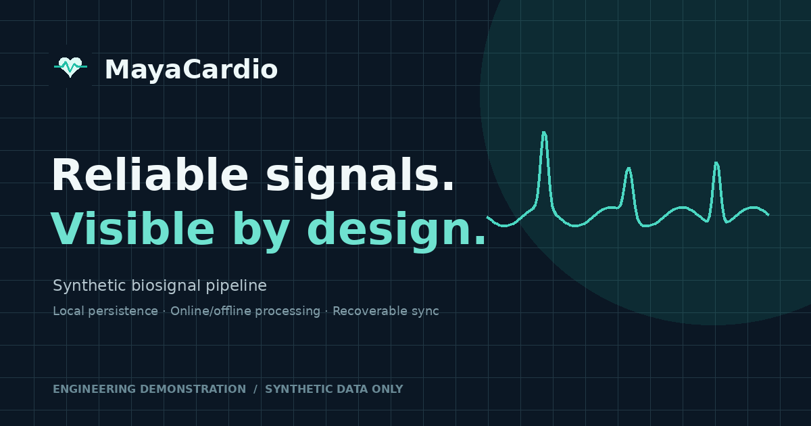
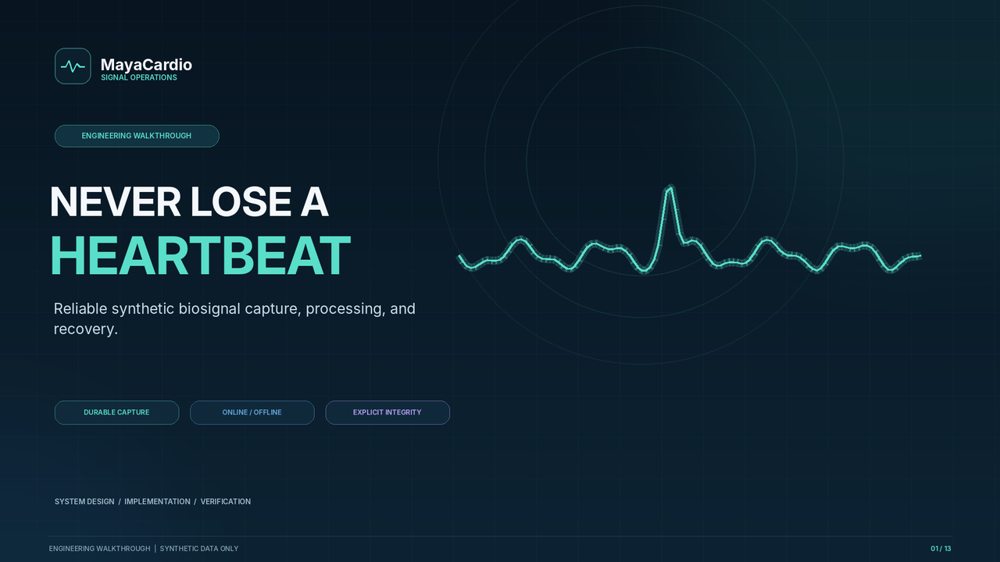
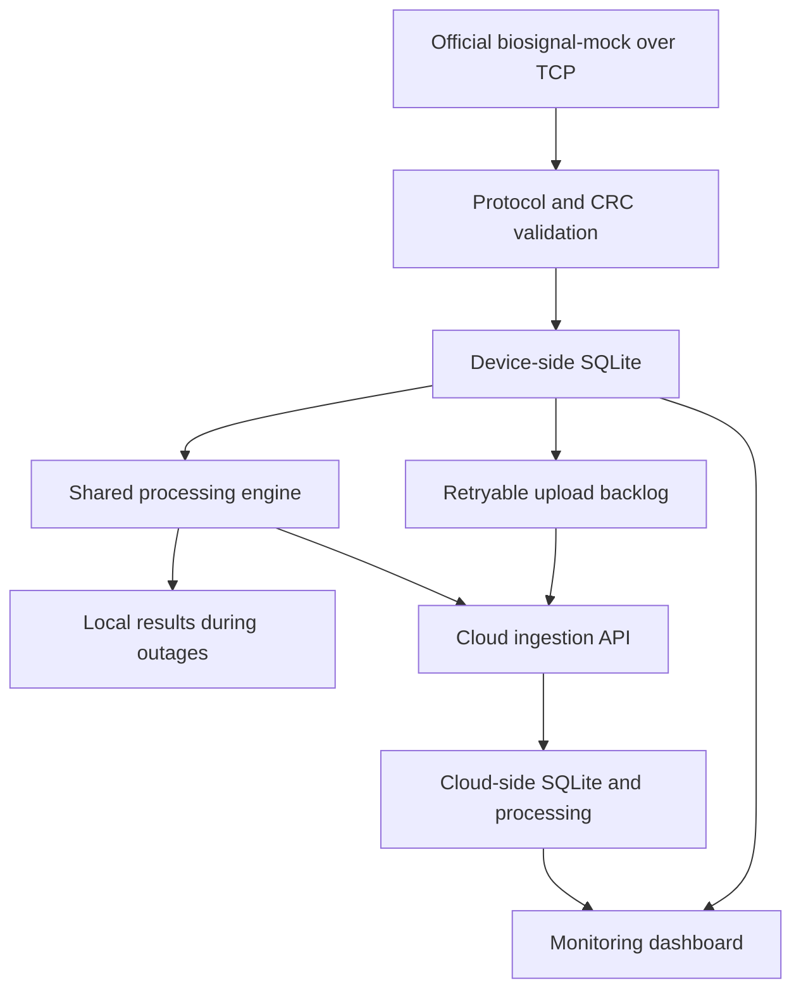

<div align="center">
  
  <h1>MayaCardio - Never Lose a Heartbeat</h1>
  <p><strong>Fault-tolerant synthetic biosignal pipeline and monitoring dashboard</strong></p>
  <p>
    
    
    
    
    
  </p>
  <p><em>Engineering demonstration for the MayaCardio Software Systems Engineer assessment, October 2026.</em></p>
</div>

> **Scope and safety:** This repository uses synthetic data only. It is an engineering demonstration, not a clinically validated monitoring or diagnostic device. The website's local cloud-service database is not a separately hosted cloud account. Official MayaCardio acceptance testing is still required.

## Contents

- [Project walkthrough](#project-walkthrough)
- [At a glance](#at-a-glance)
- [Key capabilities](#key-capabilities)
- [Architecture](#architecture)
- [Repository layout](#repository-layout)
- [Quick start on Windows](#quick-start-on-windows)
- [Persistent dashboard dataset](#4-populate-the-dashboard-with-the-persistent-demo-dataset)
- [Optional local sensor pipeline](#optional-run-the-sensor-pipeline-locally)
- [Command-line reference](#command-line-reference)
- [Frontend checks](#frontend-quality-checks)
- [Final assessment validation](#final-assessment-validation)
- [Production and security](#production-and-security-notes)
- [Documentation](#documentation)

## Project walkthrough

[](https://github.com/Adarsh0414/mayacardio-never-lose-a-heartbeat/issues/1#issue-5882566768)

*Click the preview to watch the narrated 720p walkthrough on GitHub.*

> This is a project and dashboard walkthrough using synthetic data.

## Verification snapshot

| Area | Current state |
|---|---|
| Python regression suite | 31 tests pass in the package environment (`python -m pytest -q`). |
| Frontend production checks | Run lint, type-check, frontend tests, dependency audit, and production build on a machine with npm registry access before publishing. |
| MayaCardio official acceptance | Still pending the official mock/checker, ARM64 environment, fault tests, deadline measurements, resource report, and required demo video. |

The project distinguishes local development evidence from official acceptance evidence. Read [`docs/TEST_EVIDENCE.md`](docs/TEST_EVIDENCE.md) before treating any requirement as passed.

## At a glance

MayaCardio explores how a small device can collect two synthetic sensor streams, persist samples locally, calculate one-second results, continue processing during network outages, and synchronize records when connectivity returns. A React dashboard makes the stored sessions, results, integrity records, and system status easier to inspect.

| Area | Implementation |
|---|---|
| Device pipeline | Python, TCP newline-delimited JSON, CRC validation |
| Persistence | SQLite with sample uniqueness, loss records, and upload state |
| Processing | Shared Python processing engine for local and cloud results |
| Cloud API | FastAPI with persistent SQLite storage and authenticated ingestion |
| Website | React, TypeScript, Vite, responsive monitoring dashboard |
| Demo data | Deterministic seed-7 JSONL fixture, persisted to both local SQLite stores |
| Testing | Python unit/integration tests and frontend test tooling |

## Key capabilities

- **Durable local collection:** record validated sensor samples before relying on cloud connectivity.
- **Protocol and integrity handling:** check the mock's CRC-32, handle duplicate and corrupt replies, and track known missing ranges.
- **Online and offline processing:** use the same processing implementation and preserve result mode information.
- **Recovery and synchronization:** retry outstanding uploads and make cloud ingestion idempotent.
- **Required command-line interface:** inspect status, export samples and loss records, and retrieve per-window results as JSON Lines.
- **Operational dashboard:** view sessions, processing results, missing-data records, host metrics, and service status.
- **Reusable demo session:** load one fixed synthetic dataset, persist it, and use the same session across dashboard pages.
- **Professional web details:** shared light/dark theme, responsive layout, favicon/app icons, PWA manifest, install control, metadata, and service-worker app-shell caching.

## Architecture



The repository also includes a **development-only sensor simulator** and a separate **persistent dashboard fixture**. Neither replaces the official `biosignal-mock` during final acceptance tests.

## Repository layout

```text
pipeline/                  Collector, mock protocol, storage, processing, API, CLI
frontend/                  React + TypeScript website and monitoring dashboard
tests/                     Python unit and integration tests
data/fixtures/              Checked-in deterministic synthetic dashboard fixture
docs/                      Architecture, runbooks, security, deployment, and evidence
scripts/                    Resource measurement helper
compose.demo.yml            Optional local Docker Compose demonstration
Dockerfile                  Container image definition
```

## Quick start on Windows

### Prerequisites

- Python 3.11 or newer. Python 3.13 is supported by the project configuration.
- Node.js 20.19+ or 22.12+ and npm for the website.
- Git for version control and GitHub publishing.
- VS Code is recommended but not required. Docker is optional.

Open the repository root in PowerShell or the VS Code terminal. It is the folder containing `pyproject.toml` and `frontend/`.

### 1. Set up Python

```powershell
py -3.13 -m venv .venv
Set-ExecutionPolicy -Scope Process -ExecutionPolicy Bypass
.\.venv\Scripts\Activate.ps1
python -m pip install --upgrade pip
python -m pip install -e ".[test]"
python -m pytest
```

If Python 3.13 is not installed, use another installed Python version that satisfies the `requires-python` setting in `pyproject.toml`.

### 2. Start the FastAPI service

In **Terminal 1**, from the repository root:

```powershell
.\.venv\Scripts\Activate.ps1
New-Item -ItemType Directory -Force .\data | Out-Null
$env:APP_ENV = "development"
$env:ENABLE_SYNTHETIC_DEMO_SEED = "true"
$env:CLOUD_DB_PATH = ".\data\cloud.db"
$env:PIPELINE_DB_PATH = ".\data\device.db"
$env:DASHBOARD_DEVICE_DB_PATH = ".\data\device.db"
$env:CLOUD_API_TOKEN = "demo-only-change-me"
python -m uvicorn pipeline.cloud_app:app --host 127.0.0.1 --port 8000
```

Keep this terminal open. The token is for local loopback development only. Do not use it on a public service.

### 3. Start the website

In **Terminal 2**:

```powershell
Set-Location .\frontend
npm install
npm run dev
```

Open the local URL printed by Vite, normally `http://127.0.0.1:5173/`. Keep both the API and Vite server running while using the website.

After `npm install` succeeds for the first time, commit the generated `frontend/package-lock.json`. For reproducible installs after the lockfile is committed, use `npm ci`.

### 4. Populate the dashboard with the persistent demo dataset

On the website, choose **Open dashboard** and click **Load demo dataset** on Overview. The deterministic fixture is sourced from `data/fixtures/synthetic_demo_seed7.jsonl`. The API validates the fixture and writes a runtime JSONL file at `data/synthetic_demo_dataset.jsonl`, then persists the same sample records in `data/device.db` and `data/cloud.db`.

The dataset contains:

- 30 seconds of synthetic data at 400 Hz.
- 23,960 sample rows: 12,000 for Sensor 1 and 11,960 for Sensor 2.
- 30 derived one-second windows.
- One explicitly recorded Sensor 2 gap from sample index 4,800 through 4,839.
- Three windows marked offline for a clear mode comparison.

The dashboard reads metrics and results from persisted records. Repeated loading reuses the fixed demo session instead of appending duplicate samples. The fixture is for a website walkthrough only; it does not prove official collector correctness, timing, cloud deployment, or hardware durability.

## Optional: run the sensor pipeline locally

This path exercises the development-only TCP mock, collector, local storage, and local FastAPI cloud service. It is not a substitute for the official mock.

Keep the API running as described above. Open **Terminal 3** at the repository root and start the development mock immediately before starting the pipeline. Its unread-data buffer is intentionally limited, so do not start the mock and leave it idle for a long time.

**Terminal 3 - development mock:**

```powershell
.\.venv\Scripts\Activate.ps1
python -m pipeline.demo_mock --mode signal --seed 7 --duration 1800 --port 7100 --speed 1
```

Copy the session ID printed by the mock and leave the mock running.

**Terminal 4 - device pipeline:**

```powershell
.\.venv\Scripts\Activate.ps1
New-Item -ItemType Directory -Force .\data | Out-Null
$env:PIPELINE_DB_PATH = ".\data\device.db"
$env:MOCK_HOST = "127.0.0.1"
$env:MOCK_PORT = "7100"
$env:CLOUD_URL = "http://127.0.0.1:8000"
$env:CLOUD_API_TOKEN = "demo-only-change-me"
python -m pipeline.cli run
```

Stop the pipeline with `Ctrl+C` before stopping the mock and API. The live pipeline and dashboard fixture use different session IDs, but they may share the same configured SQLite files.

## Command-line reference

Run commands from the repository root with the Python environment activated:

```powershell
python -m pipeline.cli status
python -m pipeline.cli db-check
python -m pipeline.cli export --session "SESSION_ID" --from device
python -m pipeline.cli export --session "SESSION_ID" --from cloud
python -m pipeline.cli results --session "SESSION_ID"
```

- `status` reports mode, saved sample rows, cloud sample rows when reachable, backlog, and session count.
- `db-check` runs SQLite's integrity check.
- `export` prints one JSON object per sample followed by explicit loss rows. Select `device` or `cloud` as the source.
- `results` prints known per-window results, including missing counts, completeness, channel statistics, magnitude, heart rate, and processing mode.

Redirect large exports to a file when reviewing them, for example `python -m pipeline.cli results --session "SESSION_ID" > results.jsonl`.

## Frontend quality checks

Run these commands from `frontend/` after dependencies are installed:

```powershell
npm run lint
npm run typecheck
npm test
npm run audit
npm run build
```

The production build creates `frontend/dist/`. FastAPI serves that build from `/` when the directory is present. Before publishing, fix any lint, type-check, test, audit, or build failures and retain the generated `frontend/package-lock.json`.

## Final assessment validation

The project package does **not** include MayaCardio's official `biosignal-mock` executable or `check_ground_truth` tool. Obtain the official files and their invocation instructions from PAT/MayaCardio if they were not provided separately. Do not use the development mock or dashboard fixture as a replacement for official assessment evidence.

The following items remain separate acceptance work and must not be reported as passed until measured in the required environment:

- Official ground-truth comparison of device and cloud exports.
- ARM64 Linux or Raspberry Pi 4 execution within the device limits of at most 4 CPU cores and 2 GB RAM.
- Process-kill, reboot, and physical power-cut tests with documented loss bounds.
- Formal verification of the five-second cloud-result and ten-second online/offline switching targets.
- Recovery after an outage of up to two hours, completing synchronization within 15 minutes.
- One-hour CPU, memory, disk-write, and network-use measurements.
- The required demonstration video showing a network cut, process kill, and physical power interruption.

After running on the official environment, record the exact environment, commands, session ID, durations, checker output, resource measurements, and evidence filenames in `docs/TEST_EVIDENCE.md`.

## Production and security notes

- Do not expose the Vite development server to the public internet.
- Use unique secrets, HTTPS, persistent protected storage, and the dashboard authentication configuration described in [`docs/SECURITY.md`](docs/SECURITY.md) and [`docs/DEPLOYMENT.md`](docs/DEPLOYMENT.md).
- Keep `.env`, credentials, runtime SQLite databases, runtime JSONL exports, `node_modules/`, and `frontend/dist/` out of Git.
- Do not enable synthetic demo seeding on a public deployment unless you have explicitly reviewed and intended that behavior.
- Set a real public origin before creating a production build so canonical, Open Graph, and sitemap metadata do not use a placeholder hostname.
- The UI describes engineering signals and synthetic records only. It does not provide medical advice or validated clinical measurements.

## Documentation

- [Step-by-step run and GitHub guide](docs/STEP_BY_STEP_RUN_AND_GITHUB.md)
- [Start the website on Windows](docs/START_WEBSITE_ON_WINDOWS.md)
- [Website guide](docs/WEBSITE_GUIDE.md)
- [System architecture](docs/ARCHITECTURE.md)
- [Security notes](docs/SECURITY.md)
- [Deployment guide](docs/DEPLOYMENT.md)
- [Design note](docs/DESIGN_NOTE.md)
- [Test evidence and outstanding work](docs/TEST_EVIDENCE.md)
- [Pipeline failure-demo script](docs/DEMO_SCRIPT.md)
- [Dashboard presentation walkthrough](docs/DASHBOARD_PRESENTATION_SCRIPT.md)

## AI assistance disclosure

OpenAI ChatGPT was used to assist with architecture, implementation, test design, website development, and documentation. Before submitting or presenting the project, review the code and evidence yourself, verify the behavior in the target environment, and be prepared to explain the design decisions, guarantees, assumptions, and limitations.

## License

The project files are distributed under the MIT License in [`LICENSE`](LICENSE). Any official MayaCardio mock, checker, or separately supplied material remains subject to its own terms and is not included in this repository.
